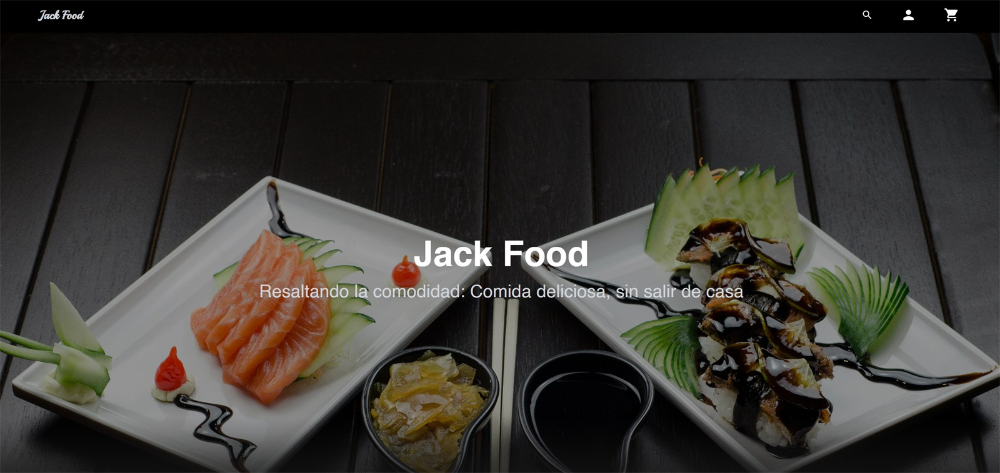
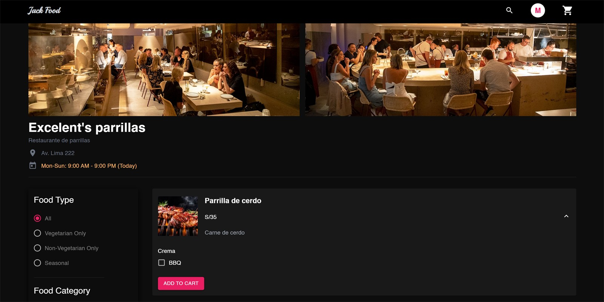

<div align="center">

# JackFood 🍔

**A full-stack food delivery platform — browse restaurants, build a cart, pay with Stripe, and track orders in real time.**

React 18 SPA · Spring Boot 3 REST API · MySQL · JWT auth

[](https://openjdk.org/projects/jdk/17/)
[](https://spring.io/projects/spring-boot)
[](https://react.dev/)
[](https://mui.com/)
[](https://redux.js.org/)
[](https://www.mysql.com/)
[](https://stripe.com/docs/payments/checkout)
[](https://jwt.io/)

</div>

<p align="center">
  
</p>

## Overview

JackFood is a food-delivery application built for three audiences from a single codebase:

- **Customers** discover nearby restaurants, filter menus, order, pay online and follow their orders.
- **Restaurant owners and managers** manage their menu, ingredients, categories, events and incoming orders.
- **Super admins** oversee customers, restaurants and restaurant sign-up requests.

The frontend is a React single-page app; the backend exposes a stateless REST API secured with JWT and integrates Stripe Checkout for payments and Gmail SMTP for transactional email.

## Table of contents

- [Features](#features)
- [Screenshots](#screenshots)
- [Tech stack](#tech-stack)
- [Architecture](#architecture)
- [Repository structure](#repository-structure)
- [Getting started](#getting-started)
- [Configuration](#configuration)
- [API reference](#api-reference)
- [Scripts](#scripts)
- [Roadmap](#roadmap)
- [Contributing](#contributing)

## Features

### For customers

- Search restaurants by name and city, with a dedicated search page.
- Restaurant pages with address, opening hours, menu categories and dietary filters (vegetarian, non-vegetarian, seasonal).
- Menu items with add-on ingredients (extras) and per-item pricing.
- Shopping cart with quantity management and persistent state.
- Checkout through **Stripe Checkout**: creating an order returns a payment URL and the app redirects to it, landing back on a success page.
- Customer profile: personal data, order history, delivery addresses, favourites, events and notifications.
- Reviews per restaurant, with average rating.
- Sign-up, login, password reset by email and password-change confirmation.

### For restaurant owners and managers

- Dashboard with sales snapshot cards.
- Live order desk: accept, prepare and update order status.
- Menu management: create, edit and remove dishes and categories.
- Ingredient and ingredient-category management, used to build item add-ons.
- Event management for seasonal or promotional offerings.
- Restaurant creation and profile details.

### For super admins

- Global dashboard.
- Customer directory.
- Restaurant directory.
- Review and approval of restaurant sign-up requests.

## Screenshots

| Landing page | Restaurant menu |
| --- | --- |
|  |  |
| Hero, search and cart access | Address, hours, dietary filters and add-to-cart |

## Tech stack

| Layer | Technology |
| --- | --- |
| **Frontend** | React 18, Create React App 5, React Router 6, Redux + Redux Thunk, Material UI 5, Axios, Formik + Yup, Day.js, React Slick |
| **Backend** | Java 17, Spring Boot 3.1.3, Spring Web, Spring Data JPA, Spring Security, Bean Validation, Lombok |
| **Auth** | JWT (JJWT) with a stateless security filter chain and role-based access |
| **Payments** | Stripe Java SDK — Checkout Sessions |
| **Email** | Spring Mail over Gmail SMTP (password reset, notifications) |
| **Database** | MySQL 8 with Hibernate schema update |
| **Build** | Maven Wrapper (backend) · npm / react-scripts (frontend) |

## Architecture

```
┌──────────────────────────┐        HTTPS / JSON         ┌───────────────────────────┐
│      React SPA           │  ───────────────────────►   │      Spring Boot API      │
│  React Router · Redux    │   Authorization: Bearer …   │  Controller → Service →   │
│  MUI · Axios             │  ◄───────────────────────   │  Repository (JPA)         │
└──────────────────────────┘                             └─────────────┬─────────────┘
        │  localhost:3000                                             │
        │                                        ┌───────────────────┼───────────────────┐
        │                                        ▼                   ▼                   ▼
        │                                   ┌─────────┐        ┌──────────┐        ┌──────────┐
        └──── Stripe Checkout ────────────► │  MySQL  │        │  Stripe  │        │  Gmail   │
               (redirect + callback)         └─────────┘        └──────────┘        │   SMTP   │
                                                                                  └──────────┘
```

The API is stateless: every protected request carries a JWT in the `Authorization` header, validated by a `OncePerRequestFilter` before the Spring Security chain.

## Repository structure

```
JackFood/
├── backend/                        Spring Boot REST API
│   ├── src/main/java/com/jack/
│   │   ├── config/                 Security (JWT filter, CORS), app beans
│   │   ├── controller/             17 REST controllers
│   │   ├── service/                Business logic (interfaces + implementations)
│   │   ├── repository/             15 Spring Data JPA repositories
│   │   ├── model/                  JPA entities
│   │   ├── domain/                 Enums (roles, order status)
│   │   ├── request/ response/ dto/ API payloads
│   │   └── Exception/              Domain exceptions and handlers
│   ├── src/main/resources/application.properties
│   └── pom.xml
└── frontend/                       React single-page app
    ├── src/customers/              Customer pages and components
    ├── src/Admin/                  Restaurant owner / manager area
    ├── src/SuperAdmin/             Platform administration area
    ├── src/Routers/                Route trees per audience
    ├── src/State/                  Redux slices (auth, customers, store, admin…)
    ├── src/config/api.js           Axios client and API base URL
    └── package.json
```

## Getting started

### Prerequisites

| Tool | Version |
| --- | --- |
| JDK | 17+ |
| MySQL | 8+ |
| Node.js | 18+ |
| npm | 9+ |

### 1. Configure and run the backend

Set the database connection and integration keys in `backend/src/main/resources/application.properties` (see [Configuration](#configuration)).

```bash
cd backend
./mvnw spring-boot:run
```

On Windows:

```bash
cd backend
mvnw.cmd spring-boot:run
```

The API starts on **http://localhost:5454**. Tables are created or updated automatically by Hibernate on first boot.

### 2. Run the frontend

```bash
cd frontend
npm install
npm start
```

The app opens on **http://localhost:3000** and talks to `http://localhost:5454`, configured in `frontend/src/config/api.js`. The backend CORS configuration already allows `http://localhost:3000`.

## Configuration

Backend settings live in `backend/src/main/resources/application.properties`:

| Property | Default | Notes |
| --- | --- | --- |
| `server.port` | `5454` | Must match `API_URL` in `frontend/src/config/api.js` |
| `spring.datasource.url` | *placeholder* | Set your JDBC URL, e.g. `jdbc:mysql://localhost:3306/fooddelivery` |
| `spring.datasource.username` | `${DB_USERNAME:root}` | Override with the `DB_USERNAME` environment variable |
| `spring.datasource.password` | `${DB_PASSWORD:…}` | Override with the `DB_PASSWORD` environment variable |
| `spring.jpa.hibernate.ddl-auto` | `update` | Switch to `validate` and use migrations in production |
| `stripe.api.key` | *empty* | Stripe **secret** key, used to create Checkout Sessions |
| `spring.mail.username` | *placeholder* | Gmail address used to send password-reset mail |
| `spring.mail.password` | *placeholder* | Gmail app password, not the account password |

> **Never commit real secrets.** Use environment variables or an untracked local properties file, and keep your Stripe and SMTP credentials out of Git.

## API reference

All endpoints return JSON. `/api/**` requires a valid JWT; `/api/admin/**` additionally requires the `RESTAURANT_OWNER` or `ADMIN` role.

| Prefix | Purpose | Access |
| --- | --- | --- |
| `/auth` | Sign-up, sign-in, JWT issuance, password reset request and confirmation | Public |
| `/api/restaurants` | Search, list, details and favourites | Authenticated |
| `/api/food` | Menu search and dishes by restaurant | Authenticated |
| `/api/users` | Current user profile | Authenticated |
| `/api/cart`, `/api/cart-item` | Cart contents, totals, item updates and clear | Authenticated |
| `/api/order` | Create an order (returns the Stripe payment URL) and list your orders | Authenticated |
| `/api/review` | Create and delete reviews, average rating | Authenticated |
| `/api/notifications` | Your notifications | Authenticated |
| `/api/events` | Restaurant events | Authenticated |
| `/api/admin/**` | Restaurants, menu items, ingredients, categories, events and order status for the restaurant dashboard | Restaurant owner or admin |

## Scripts

| Location | Command | Description |
| --- | --- | --- |
| `backend/` | `./mvnw spring-boot:run` | Run the API with hot reload (devtools) |
| `backend/` | `./mvnw test` | Run the backend test suite |
| `backend/` | `./mvnw package` | Build the executable JAR |
| `frontend/` | `npm start` | Development server on port 3000 |
| `frontend/` | `npm run build` | Production build in `frontend/build/` |
| `frontend/` | `npm test` | Interactive test runner |

## Roadmap

- [ ] Automated tests for the order and payment flows.
- [ ] Docker Compose for API + MySQL in a single command.
- [ ] CI pipeline (build, tests, dependency checks).
- [ ] OpenAPI specification and generated docs.
- [ ] Replace Hibernate `ddl-auto=update` with versioned migrations.
- [ ] Move secrets to environment-based profiles.

## Contributing

1. Fork the repository and create a topic branch: `feat/…`, `fix/…`, `docs/…`.
2. Keep commits focused and describe the *why* in the message.
3. Run `npm run build` and `./mvnw test` before opening a pull request.
4. Open the pull request against `main` with a short description and screenshots for UI changes.

## Origin

This monorepo consolidates the former `JackFood-React-Frontend` and `JackFood-React-Backend` repositories so the application can be developed, tested and released as one project.
